# PS105: Cyber Risk Quantification & Security Investment Optimization Platform

> A full-stack decision-support system translating enterprise asset telemetry, threat intelligence, and vulnerability findings into defensible financial risk distributions and optimal capital allocations.

[](https://github.com/Harsh-Tayal007/PS105-Cyber-Risk-Platform/actions/workflows/ci.yml)
[](https://www.python.org/)
[](https://fastapi.tiangolo.com/)
[](https://react.dev/)
[](https://www.typescriptlang.org/)
[](https://tailwindcss.com/)
[](LICENSE)

---

## Table of contents

1. [Overview](#1-overview)
2. [Screenshots and visual artifacts](#2-screenshots-and-visual-artifacts)
3. [Key features](#3-key-features)
4. [How it works and demonstration workflow](#4-how-it-works-and-demonstration-workflow)
5. [System architecture](#5-system-architecture)
6. [Mathematical and quantitative model](#6-mathematical-and-quantitative-model)
7. [Vulnerability intelligence and provenance](#7-vulnerability-intelligence-and-provenance)
8. [Relational data model](#8-relational-data-model)
9. [Executive boardroom PDF report](#9-executive-boardroom-pdf-report)
10. [Application page guide](#10-application-page-guide)
11. [Technology stack](#11-technology-stack)
12. [Getting started](#12-getting-started)
13. [Project structure](#13-project-structure)
14. [REST API reference](#14-rest-api-reference)
15. [Automated verification and testing](#15-automated-verification-and-testing)
16. [Design system and accessibility](#16-design-system-and-accessibility)
17. [Data sources and integrity disclaimers](#17-data-sources-and-integrity-disclaimers)
18. [Methodological limitations and future roadmap](#18-methodological-limitations-and-future-roadmap)
19. [Academic context](#19-academic-context)
20. [Mission, vision, and developer credits](#20-mission-vision-and-developer-credits)

---

## 1. Overview

Enterprise cybersecurity leadership faces an enduring communication divide: security practitioners report technical findings (vulnerability counts, CVSS base scores, exploit codes), while executive boards and Chief Financial Officers allocate capital based on monetary risk exposures, return on investment, and catastrophic insolvency thresholds.

PS105 resolves this gap by addressing a fundamental executive question:

> *"Given our synthetic organizational assets, applicable public vulnerabilities, threats, and a constrained cybersecurity budget, which specific combination of security controls should we purchase to achieve the maximum practical reduction in expected financial cyber loss?"*

### Target audience
* **Chief Information Security Officers (CISOs):** Build defensible, mathematically grounded capital expenditure proposals that withstand fiscal scrutiny.
* **Chief Financial Officers (CFOs) and Risk Committees:** Assess Value-at-Risk ($VaR_{95}$), inspect empirical loss exceedance curves, and audit exact capital returns per rupee deployed.
* **Security Analysts and Auditors:** Inspect deterministic vulnerability provenance with zero false positives from missing version metadata.

### What PS105 is not
* **Not an active network scanner:** PS105 initiates zero port scans, issues no raw socket probes, deploys no endpoint agents, and initiates no dynamic network penetration.
* **Not a live feed scraper during runtime:** Ingestion of public CVE records, CVSS metrics, and CISA KEV tags is locally cached for deterministic reproducibility and speed.
* **Not certified ISO 27005 or certified FAIR:** PS105 employs a **FAIR-inspired quantitative methodology** and deterministic/stochastic engines. It makes no claims of formal regulatory certification.

---

## 2. Screenshots and visual artifacts

### Application user interface (SPA Views)

| Executive Overview | Risk Quantification & Heatmap |
| :---: | :---: |
| 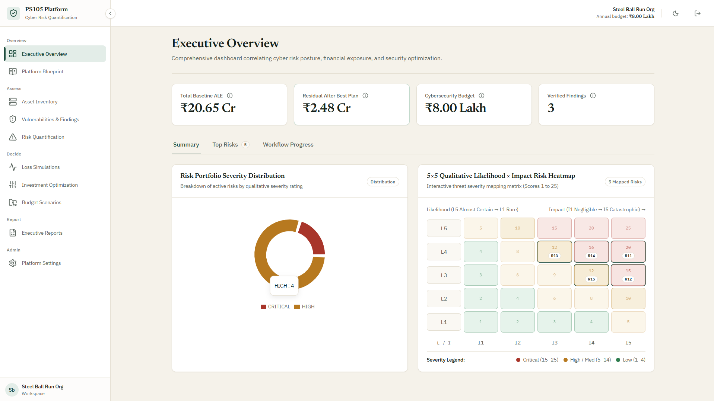 | 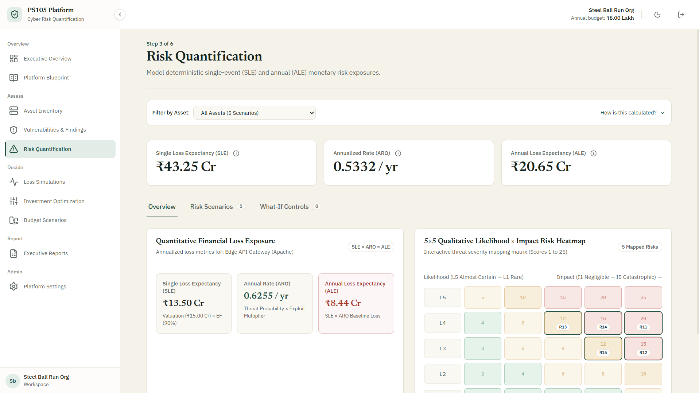 |

| Monte Carlo Loss Simulations | Investment Optimization (MILP Solver) |
| :---: | :---: |
| 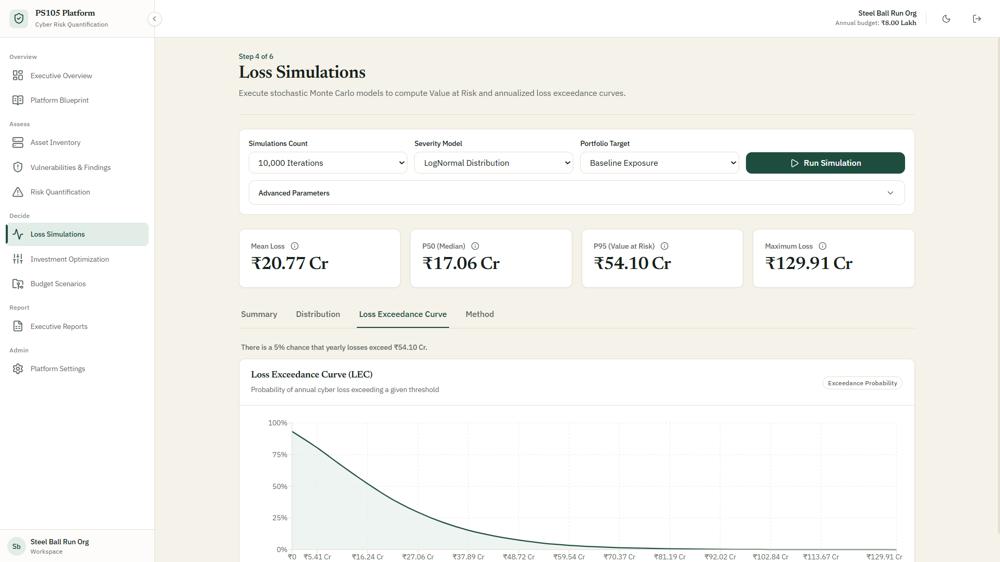 | 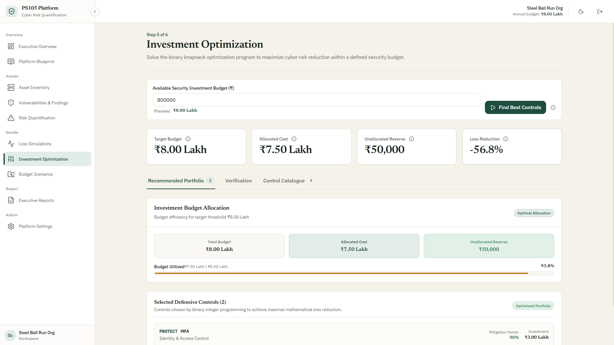 |

| Budget Scenarios & Efficient Frontier | Executive Reports Generator |
| :---: | :---: |
| 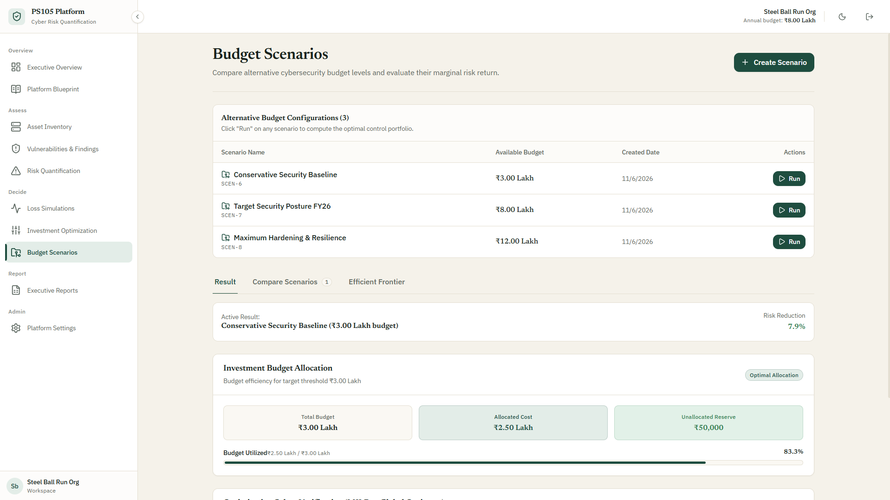 | 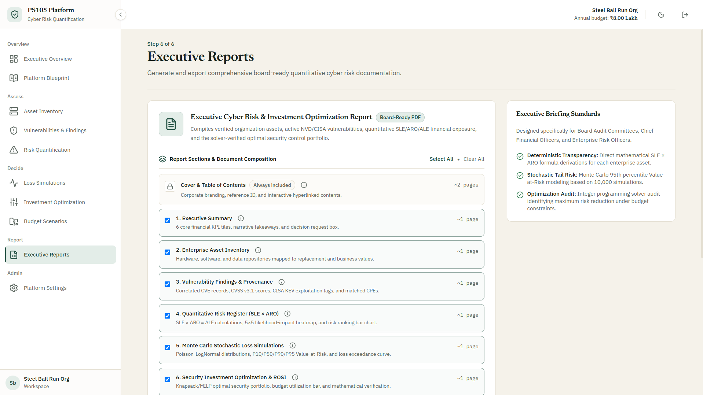 |

| Asset Inventory | Vulnerability Findings |
| :---: | :---: |
| 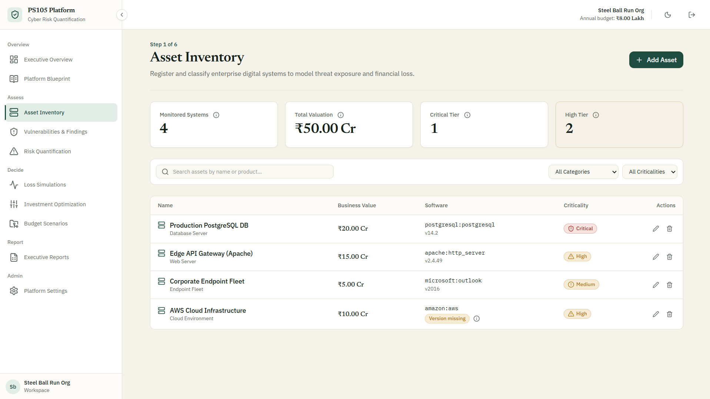 | 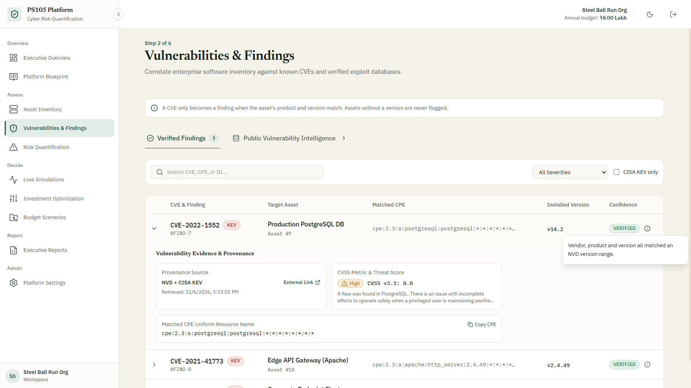 |

| Platform Blueprint (12 Specifications) | Authentication & Demo Access |
| :---: | :---: |
| 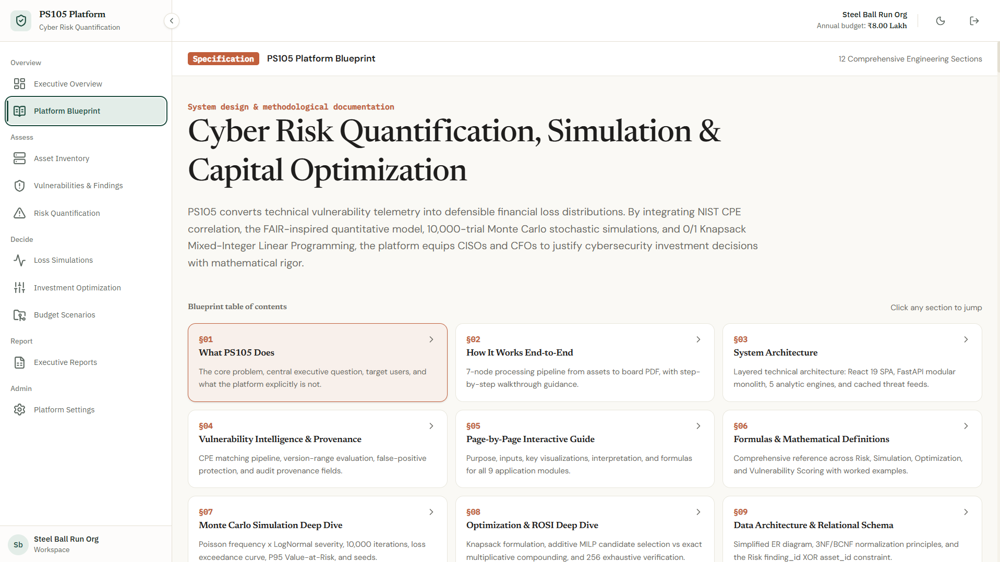 | 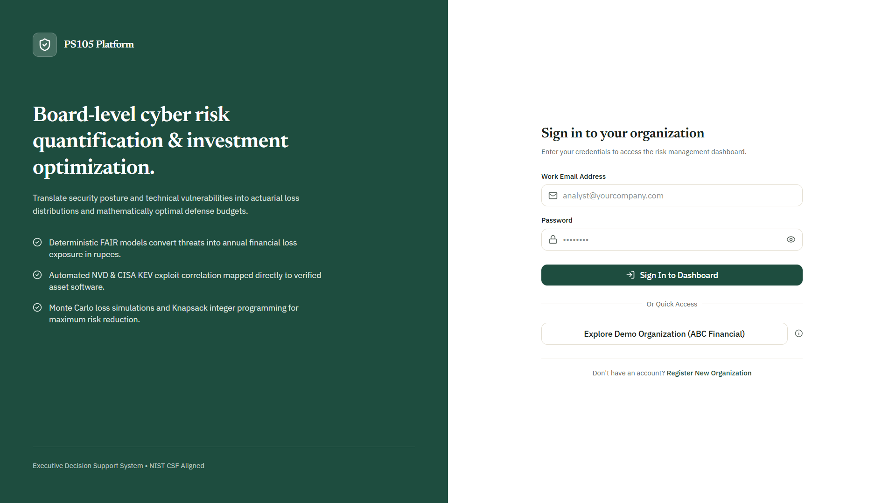 |

<details>
<summary><b>View complete interface capture index</b></summary>

| View Name | Primary Theme | File Path | Status |
| :--- | :--- | :--- | :--- |
| **Login & Demo Entry** | Paper Light | [`01_login_light.png`](docs/screenshots/01_login_light.png) | Captured |
| **Executive Overview** | Paper Light | [`02_overview_light.png`](docs/screenshots/02_overview_light.png) | Captured |
| **Asset Inventory** | Paper Light | [`03_assets_light.png`](docs/screenshots/03_assets_light.png) | Captured |
| **Vulnerability Findings** | Paper Light | [`04_vulnerabilities_light.png`](docs/screenshots/04_vulnerabilities_light.png) | Captured |
| **Risk Quantification & Heatmap** | Paper Light | [`05_risks_light.png`](docs/screenshots/05_risks_light.png) | Captured |
| **Monte Carlo Loss Simulations** | Paper Light | [`06_simulations_light.png`](docs/screenshots/06_simulations_light.png) | Captured |
| **Investment Optimization & Solver** | Paper Light | [`07_optimization_light.png`](docs/screenshots/07_optimization_light.png) | Captured |
| **Budget Scenarios & Frontier** | Paper Light | [`08_scenarios_light.png`](docs/screenshots/08_scenarios_light.png) | Captured |
| **Executive Reports Generator** | Paper Light | [`09_reports_light.png`](docs/screenshots/09_reports_light.png) | Captured |
| **Platform Blueprint (12 Sections)** | Paper Light | [`10_blueprint_light.png`](docs/screenshots/10_blueprint_light.png) | Captured |

</details>

### Generated Executive PDF Report (ReportLab Platypus)

The platform automatically synthesizes enterprise telemetry and solver outputs into a 13-page, publication-grade executive PDF report with vector loss curves, discrete probability distributions, and capital allocation audits:

| Page 1: Cover & Metadata | Page 2: Executive Summary & KPIs | Page 5: 5×5 Risk Heatmap |
| :---: | :---: | :---: |
| 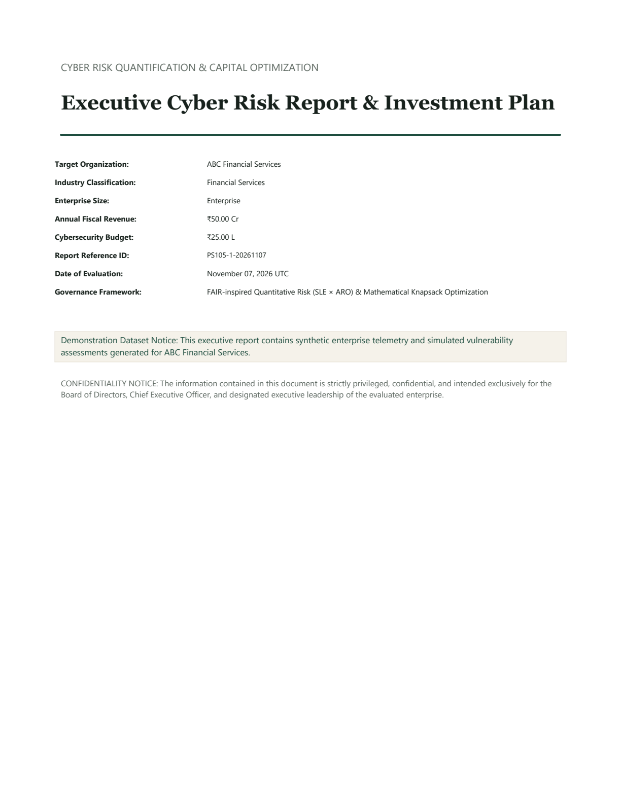 | 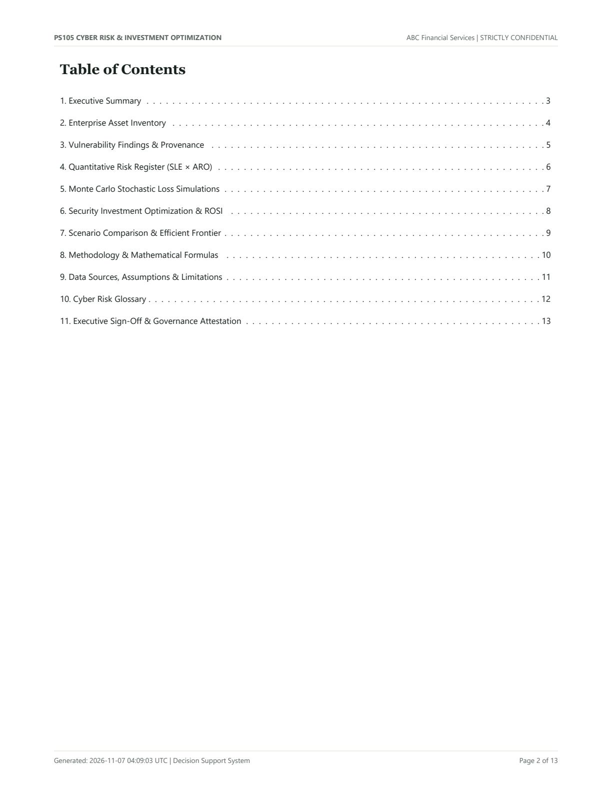 | 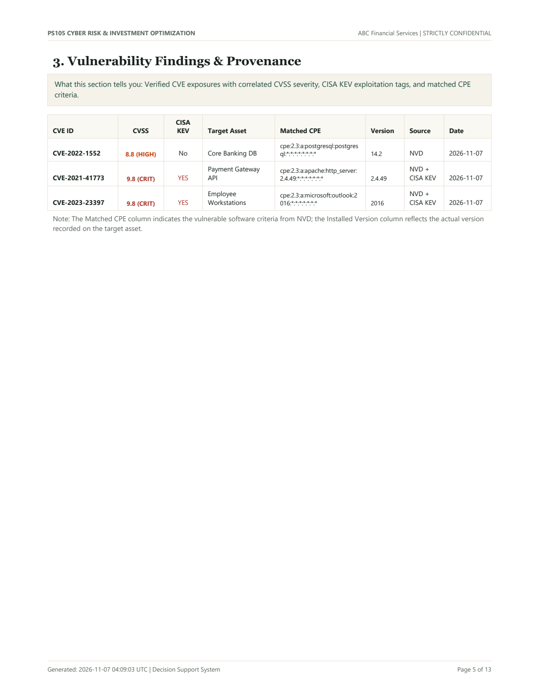 |

| Page 6: Monte Carlo Exceedance | Page 7: Portfolio Optimization | Page 8: Efficient Frontier Scenarios |
| :---: | :---: | :---: |
| 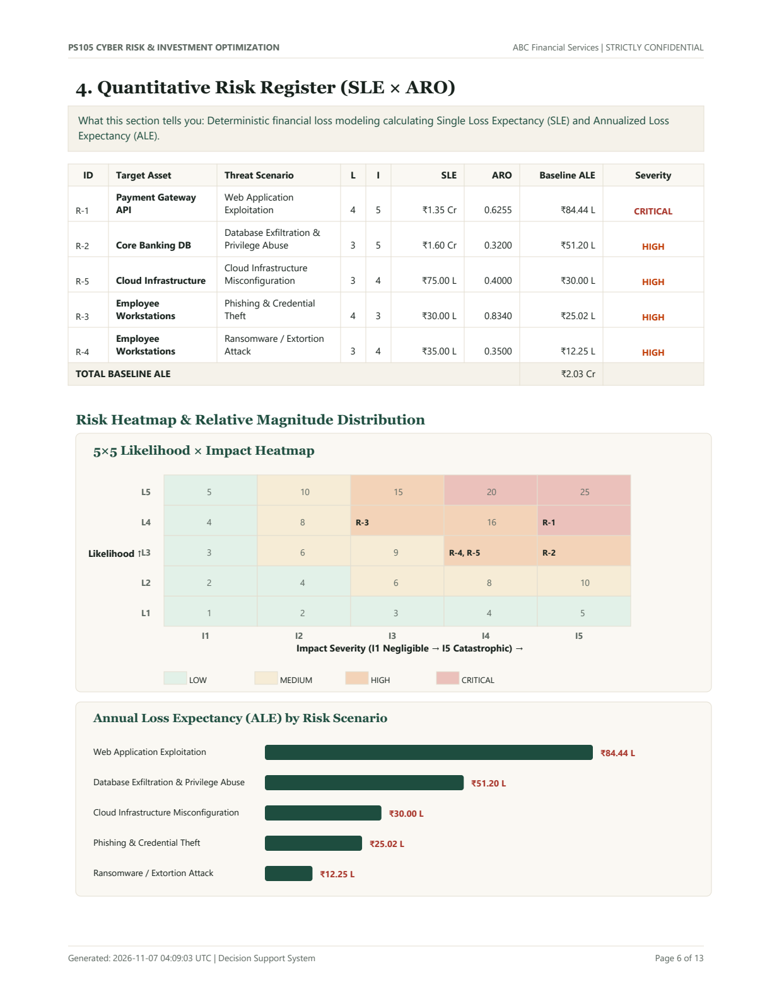 | 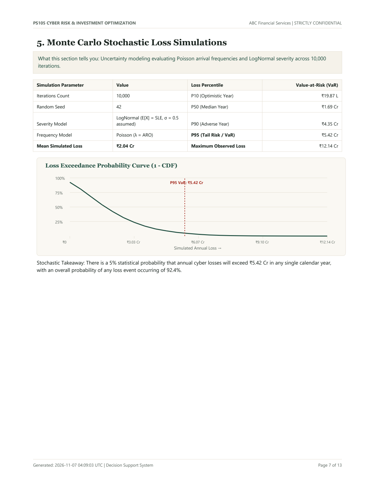 | 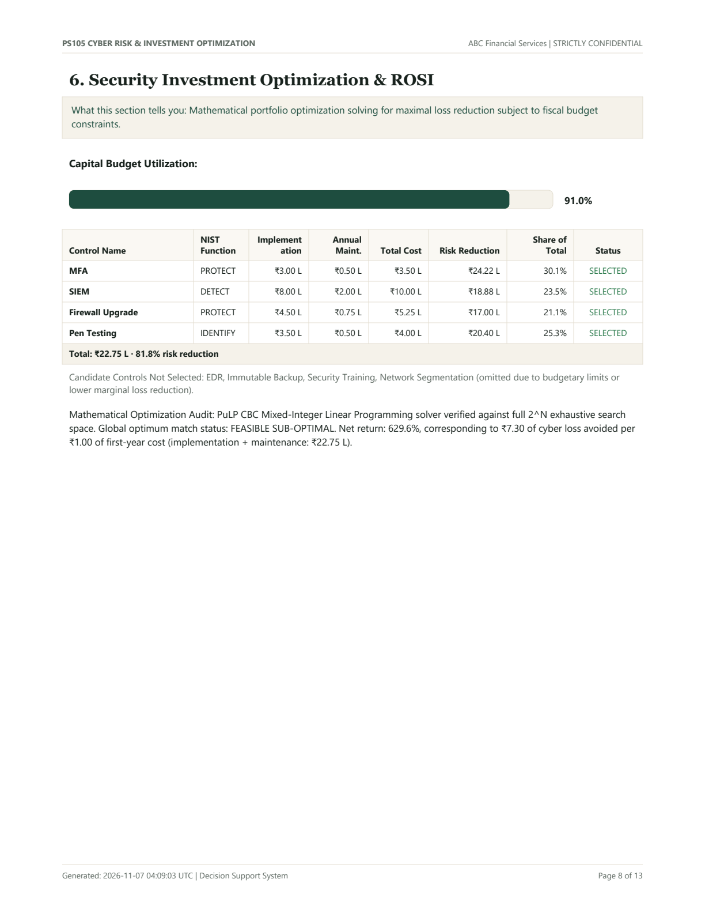 |

<details>
<summary><b>Click to view all 13 report page preview links</b></summary>

* [Page 1: Title & Classification Cover](docs/screenshots/page_01.png)
* [Page 2: Executive Financial Summary & KPI Tiles](docs/screenshots/page_02.png)
* [Page 3: Organizational Asset Valuation Schedule](docs/screenshots/page_03.png)
* [Page 4: Correlated Vulnerability Findings](docs/screenshots/page_04.png)
* [Page 5: Qualitative 5×5 Risk Assessment Heatmap](docs/screenshots/page_05.png)
* [Page 6: Stochastic Monte Carlo Simulation & Loss Curve](docs/screenshots/page_06.png)
* [Page 7: Mixed-Integer Linear Programming Optimization](docs/screenshots/page_07.png)
* [Page 8: Multi-Scenario Budget Efficient Frontier](docs/screenshots/page_08.png)
* [Page 9: Optimization Governance & Fiduciary Audit](docs/screenshots/page_09.png)
* [Page 10: FAIR-Inspired Mathematical Methodology](docs/screenshots/page_10.png)
* [Page 11: Quantitative Limitations & Boundary Conditions](docs/screenshots/page_11.png)
* [Page 12: Technical Glossary & Formula References](docs/screenshots/page_12.png)
* [Page 13: Executive Attestation & Sign-Off Schedule](docs/screenshots/page_13.png)

</details>

---

## 3. Key features

* **Deterministic CPE & Vulnerability Matching:** Matches declared software inventory against NIST Common Platform Enumerations (CPE) using semantic interval comparisons with strict false-positive elimination (`INSUFFICIENT_DATA` handling).
* **FAIR-Inspired Quantitative Risk Modeling:** Converts technical telemetry into Single Loss Expectancy ($SLE$) and Annualized Rate of Occurrence ($ARO$) to calculate deterministic baseline Annualized Loss Expectancy ($ALE = SLE \times ARO$).
* **Vectorized 10,000-Trial Monte Carlo Engine:** Simulates compound renewal processes (Poisson threat frequency $\times$ LogNormal severity with $\sigma = 0.5$) in under 50 milliseconds via NumPy, extracting $P10, P50, P90, P95$ Value-at-Risk and empirical Loss Exceedance Curves.
* **0/1 Knapsack Mixed-Integer Linear Programming (MILP):** Optimal security control portfolio selection solved via the COIN-OR CBC branch-and-cut solver (PuLP), backed by non-linear multiplicative residual evaluation ($\prod (1 - E_{ij} x_i)$) and exhaustive $2^8 = 256$ state space global verification.
* **Multi-Scenario Efficient Frontier:** Evaluates diminishing marginal returns across distinct budgetary allocations (e.g. ₹10 L, ₹25 L, ₹40 L) and calculates marginal risk reduction per rupee.
* **13-Page Consulting-Grade Executive PDF Report:** Generated on-demand via ReportLab Platypus with vector canvas charts, clickable Table of Contents, revenue sanity callouts, and modular section filtering (`?sections=`).
* **In-App Platform Blueprint:** Comprehensive 12-section technical specification page directly inside the SPA with KaTeX mathematical formulas and live scrollspy.
* **Editorial Design System:** Warm "Paper" light theme (`#F5F2EA`) and "Obsidian" dark theme (`#111613`) with Newsreader serif and IBM Plex typography.

---

## 4. How it works and demonstration workflow

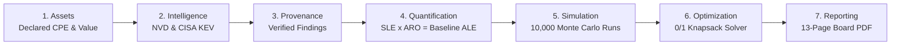

### Demonstration in 6 steps (ABC Financial Services)

1. **One-Click Demo Authentication:** Access the platform using the pre-seeded "ABC Financial Services" enterprise profile (₹50 Cr revenue, ₹25 L budget).
2. **Review Verified Asset Findings:** Inspect 4 assets and 3 verified CVE findings (CVE-2021-41773, CVE-2022-1552, CVE-2023-23397). Note that Cloud Infrastructure produces 0 findings due to missing installed version metadata.
3. **Inspect Deterministic Risks:** View the 5 modeled threat scenarios yielding a Baseline ALE of ₹2.03 Crore (4.06% of annual revenue).
4. **Execute Stochastic Simulations:** Run 10,000 Monte Carlo iterations to evaluate Poisson breach frequency and LogNormal tail loss ($P95 = \text{₹5.41 Cr}$).
5. **Solve Optimal Capital Allocation:** Run the MILP solver against the ₹25.0 Lakh budget. The solver selects MFA, SIEM, Firewall Upgrade, and Pen Testing, investing ₹22.75 Lakh to achieve an 81.8% loss reduction (Residual Loss: ₹36.92 Lakh) yielding a **6.30× Net ROSI**.
6. **Generate Boardroom Audit Report:** Stream the 13-page consulting-grade PDF document containing full provenance ledgers and executive sign-off blocks.

---

## 5. System architecture

PS105 is built as an enterprise-grade **modular monolith**, cleanly separating client presentation, REST routing, pure calculation engines, and relational persistence:

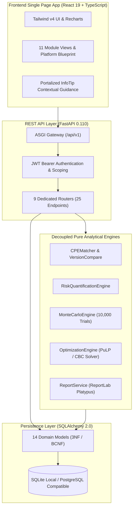

For comprehensive structural analysis, see [docs/architecture.md](docs/architecture.md).

---

## 6. Mathematical and quantitative model

| Metric / Step | Definitive Mathematical Formula | Full Form | Operational Business Meaning |
| :--- | :--- | :--- | :--- |
| **SLE** | $\text{SLE} = V_{\text{asset}} \times \text{EF}$ | Single Loss Expectancy | Monetary loss expected from a single successful compromise incident. |
| **$M_{\text{exploit}}$** | $1.0 + \frac{\text{CVSS Exploitability}}{10.0}$ | Exploitability Multiplier | Amplification factor reflecting ease of technical exploitability (1.0 for direct threats). |
| **ARO** | $\text{ARO} = P_{\text{threat}} \times M_{\text{exploit}}$ | Annualized Rate of Occurrence | Statistically expected frequency of successful threat events per calendar year. |
| **Baseline ALE** | $\text{ALE} = \text{SLE} \times \text{ARO}$ | Annualized Loss Expectancy | Deterministic expected annual monetary exposure for an individual risk scenario. |
| **Residual ALE** | $\text{ALE} \times \prod_{i \in S} (1 - E_{ij} x_i)$ | Residual Risk Exposure | Remaining expected annual loss following multiplicative control mitigation. |
| **Poisson Freq.** | $N \sim \text{Poisson}(\lambda = \text{ARO})$ | Poisson Arrival Process | Random number of breach incidents occurring during a single simulated year. |
| **LogNormal Sev.** | $L \sim \text{LogNormal}(\mu, \sigma=0.5)$ | LogNormal Loss Severity | Stochastic financial severity per incident parameterized with $\mathbb{E}[L] = \text{SLE}$. |
| **Knapsack MILP** | $\max \sum R_i^{\text{add}} x_i \text{ s.t. } \sum C_i x_i \le B$ | Mixed-Integer Linear Program | Optimal 0/1 binary control selection maximizing additive risk reduction under budget $B$. |
| **Net ROSI** | $\frac{\Delta \text{Risk} - C_{\text{total}}}{C_{\text{total}}}$ | Return on Security Investment | Net financial loss avoided per rupee of first-year security expenditure. |

For complete proofs and algorithm specifications, see [docs/math-model.md](docs/math-model.md).

---

## 7. Vulnerability intelligence and provenance

PS105 ensures total auditability by eliminating false positives caused by incomplete inventory:

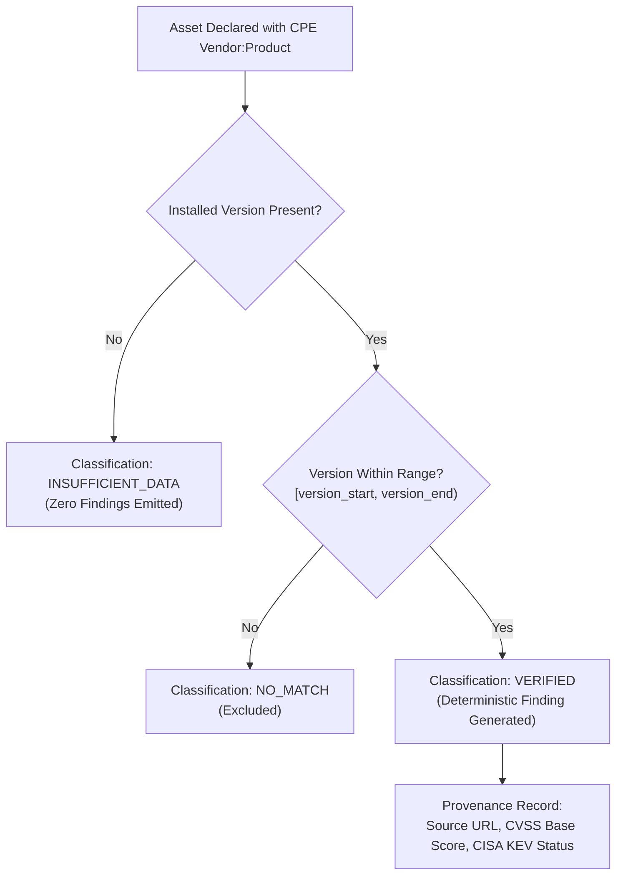

---

## 8. Relational data model

The persistence schema consists of **14 tables** normalized to 3NF/BCNF with database-level integrity constraints:

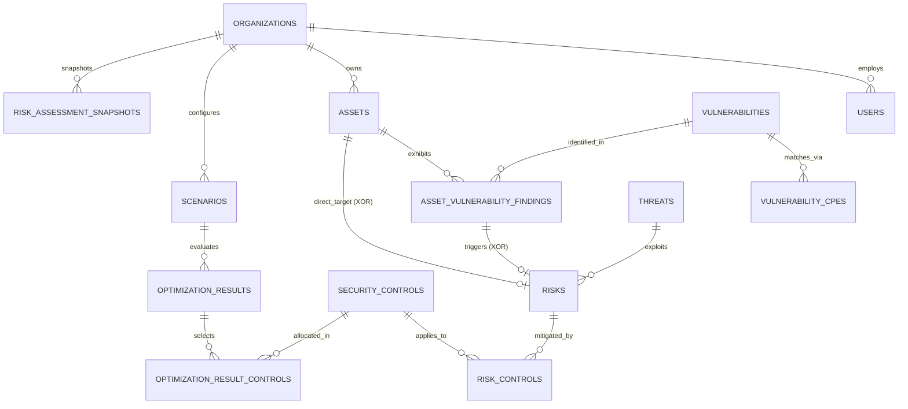

### Critical Database Integrity Invariants
* **Risk Provenance Exclusive OR (XOR) Constraint:** Enforces that a risk represents either an asset-specific threat or a vulnerability finding, never both:
  ```sql
  CHECK (
      (finding_id IS NOT NULL AND asset_id IS NULL) OR
      (finding_id IS NULL AND asset_id IS NOT NULL)
  )
  ```
* **Multi-Column Composite Keys:** Junction tables `risk_controls` and `optimization_result_controls` enforce relational uniqueness via composite primary keys.

For detailed table-by-table schema documentation, see [docs/database.md](docs/database.md).

---

## 9. Executive boardroom PDF report

The reporting engine generates a publication-quality 13-page PDF document on-demand:

1. **Cover Page:** Formal executive title banner, confidentiality classification, and target organization metadata.
2. **Table of Contents:** Dynamic two-pass page number collection with internal PDF bookmarks.
3. **§1. Executive Summary:** Boardroom narrative, 4 un-wrapped KPI tiles, and triple revenue sanity callouts.
4. **§2. Enterprise Asset Inventory:** Tabular asset register with valuations and criticality ratings.
5. **§3. Vulnerability Findings & Provenance:** Matched CVE exposures, CVSS scores, and CISA KEV tags.
6. **§4. Quantitative Risk Register (SLE × ARO):** Sorted register paired with a 5×5 Likelihood $\times$ Impact vector heatmap.
7. **§5. Monte Carlo Stochastic Simulations:** 10,000-trial summary, VaR percentiles, and vector Loss Exceedance Curve.
8. **§6. Security Investment Optimization & ROSI:** Selected controls, unit spend, individual loss reduction, and net return ($6.30\times$).
9. **§7. Scenario Comparison & Efficient Frontier:** Spend vs. Residual Loss curve labeled with scenario codes ($S1, S2, S3$).
10. **§8. Methodology & Mathematical Formulas:** Complete mathematical reference with sanitized ASCII typography.
11. **§9. Data Sources, Assumptions & Limitations:** Dedicated transparency disclosure on synthetic demonstration parameters.
12. **§10. Cyber Risk Glossary:** Formal definitions for 16 industry acronyms (ALE, ARO, KEV, MILP, ROSI, VaR).
13. **§11. Executive Sign-Off & Governance:** Signature and approval register for CISO and CFO leadership.

*Modular Generation:* Supports query filtering via `/api/v1/reports/executive-pdf?sections=summary,risks,optimization` with zero numbering gaps.  
For structural breakdown, see [docs/report-structure.md](docs/report-structure.md).

---

## 10. Application page guide

1. **Login & Registration (`/`):** Multi-tenant authentication with instant one-click demonstration dataset ingress.
2. **Executive Overview (`overview`):** High-level board summary with annualized exposure KPIs, budget consumption, and quick action cards.
3. **Platform Blueprint (`blueprint`):** 12-section in-app engineering manual with live scrollspy and KaTeX equations.
4. **Asset Inventory (`assets`):** Hardware, database, server, and cloud asset register with business valuation editing.
5. **Vulnerabilities & Findings (`vulnerabilities`):** Locally cached NVD/KEV intelligence and deterministic verified findings.
6. **Risk Quantification (`risks`):** Deterministic SLE, ARO, and Baseline ALE modeling alongside a 5×5 Likelihood $\times$ Impact Heatmap.
7. **Loss Simulations (`simulations`):** 10,000-iteration Poisson-LogNormal Monte Carlo simulator with interactive Recharts exceedance curves.
8. **Investment Optimization (`optimization`):** Mixed-integer knapsack optimizer with exact multiplicative portfolio post-evaluation.
9. **Budget Scenarios (`scenarios`):** Multi-budget planning tool comparing conservative, executive, and hardening portfolios.
10. **Executive Reports (`reports`):** Interactive report customization modal with PDF download and section selection.
11. **Platform Settings (`settings`):** Organizational profile configuration, industry tagging, and fiscal budget thresholds.

---

## 11. Technology stack

### Backend Architecture
* **Language & Runtime:** Python 3.13.2
* **Web Framework:** FastAPI `0.110.0`
* **ASGI Server:** Uvicorn `0.28.0`
* **Data Persistence:** SQLAlchemy `2.0.28` (SQLite local, PostgreSQL compatible)
* **Optimization Solver:** PuLP `2.8.0` (COIN-OR CBC branch-and-cut solver)
* **Numerical & Statistical Engine:** NumPy `1.26.4`
* **Report Generation:** ReportLab `4.1.0`
* **Authentication & Cryptography:** PyJWT `2.8.0`, Bcrypt `3.2.0`
* **Data Validation:** Pydantic v2 `2.6.4` and Pydantic-Settings `2.2.1`

### Frontend Architecture
* **Runtime & Package Manager:** Node.js `v22.14.0`, npm `11.6.1`
* **SPA Framework:** React `19.2.8` + TypeScript `6.0.2`
* **Build System:** Vite `8.2.2`
* **Styling Framework:** Tailwind CSS `v4.3.3`
* **Charting & Visualization:** Recharts `3.10.1`
* **Mathematical Rendering:** KaTeX `0.19.1`
* **Iconography:** Lucide React `1.43.0`
* **Quality Assurance:** Vitest `3.0.7`, Oxlint `1.79.0`

---

## 12. Getting started

### Prerequisites
* Python 3.13+ installed
* Node.js v22+ installed (`.nvmrc` provided)
* Git installed

### 1. Backend Setup
```bash
# Clone the repository
git clone https://github.com/Harsh-Tayal007/PS105-Cyber-Risk-Platform.git
cd PS105-Cyber-Risk-Platform

# Create and activate virtual environment
python -m venv venv
# On Windows PowerShell:
.\venv\Scripts\Activate.ps1
# On Linux/macOS:
source venv/bin/activate

# Install backend dependencies
pip install -r backend/requirements.txt
pip install -r backend/requirements-dev.txt

# Set up local environment configuration
cp backend/.env.example backend/.env

# Seed demonstration database (ABC Financial Services)
python -m backend.app.database.seed

# Start backend server
uvicorn backend.app.main:app --host 127.0.0.1 --port 8000 --reload
```

### 2. Frontend Setup
```bash
# In a new terminal window:
cd frontend

# Set up environment configuration
cp .env.example .env

# Install exact npm dependencies
npm ci

# Launch development server
npm run dev
```

### 3. Accessing the Application
* **Frontend Web App:** `http://localhost:3000`
* **FastAPI Swagger UI:** `http://localhost:8000/docs`
* **FastAPI ReDoc:** `http://localhost:8000/redoc`
* **Demo Access:** Click **"Explore Demo Organization"** on the login page to access the pre-seeded CISO workspace instantly.

---

## 13. Project structure

```
PS105-Cyber-Risk-Platform/
├── .github/                        # GitHub Actions CI & repository templates
│   ├── ISSUE_TEMPLATE/             # Bug report and feature request templates
│   ├── workflows/ci.yml            # Automated CI pipeline (Pytest + Vitest + Lint)
│   ├── CODEOWNERS                  # Global repository code owners
│   └── pull_request_template.md    # Standard PR template
├── backend/                        # Backend Python 3.13 application
│   ├── app/
│   │   ├── api/                    # Ingress routes & router aggregation
│   │   │   ├── routes/             # 9 dedicated API routers (25 endpoints)
│   │   │   └── router.py           # Central API v1 router
│   │   ├── database/               # Database connection & seed script
│   │   │   ├── connection.py       # SQLAlchemy Base & SessionLocal
│   │   │   └── seed.py             # ABC Financial Services seed logic
│   │   ├── engines/                # Decoupled algorithmic calculation engines
│   │   │   ├── cpe_matcher.py      # Semantic CPE matching engine
│   │   │   ├── monte_carlo_engine.py # Vectorized 10,000-trial simulation
│   │   │   ├── optimization_engine.py # 0/1 Knapsack MILP solver
│   │   │   ├── risk_engine.py      # Deterministic SLE x ARO engine
│   │   │   └── version_compare.py  # Semantic interval version comparator
│   │   ├── models/domain.py        # 14 SQLAlchemy ORM models (3NF/BCNF)
│   │   ├── schemas/schemas.py      # Pydantic v2 request/response schemas
│   │   ├── services/               # Orchestration & PDF generation services
│   │   │   ├── auth_service.py     # JWT & Bcrypt authentication service
│   │   │   ├── finding_service.py  # Deterministic finding generator
│   │   │   └── report_service.py   # 13-page ReportLab PDF service
│   │   ├── assets/fonts/           # Typography guidelines & license metadata
│   │   ├── config.py               # Pydantic BaseSettings environment config
│   │   └── main.py                 # FastAPI application factory & root endpoints
│   ├── tests/                      # Automated backend pytest test suite (116 tests)
│   ├── .env.example                # Backend environment template
│   ├── requirements.txt            # Production dependencies
│   └── requirements-dev.txt        # Development & test dependencies
├── frontend/                       # Frontend React 19 application
│   ├── src/
│   │   ├── components/             # Reusable UI component library
│   │   │   ├── blueprint/          # Platform Blueprint documentation sections
│   │   │   ├── charts/             # Recharts financial loss charts
│   │   │   ├── layout/             # AppLayout, Header, and Sidebar
│   │   │   └── ui/                 # Buttons, Cards, Modals, InfoTip portals
│   │   ├── context/AuthContext.tsx # JWT token state & session lifecycle
│   │   ├── lib/                    # API client, theme engine, and blueprint data
│   │   ├── pages/                  # 11 core module views & Blueprint page
│   │   ├── types/index.ts          # TypeScript type definitions
│   │   ├── App.tsx                 # Root component & state-based navigation
│   │   └── index.css               # Design system tokens & typography rules
│   ├── public/                     # Static assets & SVG icons
│   ├── .env.example                # Frontend environment template
│   ├── package.json                # Frontend dependencies & scripts
│   └── vite.config.ts              # Vite bundler & backend reverse proxy config
├── docs/                           # In-depth architectural & mathematical docs
│   ├── architecture.md             # System design & modular monolith analysis
│   ├── database.md                 # 14-entity schema & normalization proofs
│   ├── math-model.md               # Complete formulas, derivations & proofs
│   ├── api.md                      # REST API endpoint reference
│   ├── implementation-phases.md    # 12-phase engineering milestone log
│   ├── design-system.md            # Editorial UI design tokens & layout contract
│   ├── report-structure.md         # 13-page PDF layout and flowable budget
│   ├── demo-script.md              # 5-minute technical viva walkthrough
│   ├── CHANGELOG.md                # Detailed release notes
│   └── screenshots/                # Application screenshot directory
├── .gitattributes                  # Git line ending & binary normalization
├── .gitignore                      # Git exclusion rules
├── .nvmrc                          # Node.js version declaration (v22.14.0)
├── CONTRIBUTING.md                 # Contribution guidelines & branching model
├── LICENSE                         # MIT License
├── README.md                       # Comprehensive repository documentation
└── SECURITY.md                     # Security policy & vulnerability reporting
```

---

## 14. REST API reference

| Method | Endpoint | Module Tag | Description |
| :--- | :--- | :--- | :--- |
| `GET` | `/` | Root | Application metadata & service health status |
| `GET` | `/health` | Health | Database connection status verification |
| `POST` | `/api/v1/auth/register` | Authentication | Register new user account and organization |
| `POST` | `/api/v1/auth/login` | Authentication | Authenticate credentials and receive JWT |
| `POST` | `/api/v1/auth/demo` | Authentication | Instant one-click demo login for CISO account |
| `GET` | `/api/v1/organizations/me` | Organizations | Fetch caller's organization details & budget |
| `PUT` | `/api/v1/organizations/me` | Organizations | Update organizational revenue and cybersecurity budget |
| `GET` | `/api/v1/assets` | Assets | List organization asset inventory |
| `POST` | `/api/v1/assets` | Assets | Declare a new asset with CPE criteria & valuation |
| `PUT` | `/api/v1/assets/{asset_id}` | Assets | Update asset criticality, version, or value |
| `DELETE` | `/api/v1/assets/{asset_id}` | Assets | Remove asset and cascade-delete linked findings |
| `GET` | `/api/v1/vulnerabilities/intelligence` | Intel & Findings | List cached public CVE records |
| `GET` | `/api/v1/vulnerabilities/findings` | Intel & Findings | List deterministic verified vulnerability findings |
| `GET` | `/api/v1/risks/threats` | Risk Quantification | List standard threat scenario definitions |
| `GET` | `/api/v1/risks/assessment` | Risk Quantification | Retrieve full risk register with SLE, ARO, and ALE |
| `POST` | `/api/v1/risks` | Risk Quantification | Create risk mapping linking threat to asset/finding |
| `POST` | `/api/v1/risks/auto-map` | Risk Quantification | Auto-map applicable threats to findings and assets |
| `POST` | `/api/v1/risks/calculate` | Risk Quantification | Calculate residual losses for an arbitrary control set |
| `GET` | `/api/v1/controls` | Security Controls | List candidate security controls and unit costs |
| `POST` | `/api/v1/controls` | Security Controls | Declare a custom security control |
| `POST` | `/api/v1/simulations/run` | Simulations | Execute 10,000-trial Monte Carlo stochastic simulation |
| `GET` | `/api/v1/optimization/scenarios` | Optimization | List configured budget allocation scenarios |
| `POST` | `/api/v1/optimization/scenarios` | Optimization | Create budget allocation planning scenario |
| `POST` | `/api/v1/optimization/run` | Optimization | Execute 0/1 Knapsack MILP solver under budget |
| `GET` | `/api/v1/reports/executive-pdf` | Reports | Stream 13-page consulting-grade executive PDF report |

For request/response payloads, see [docs/api.md](docs/api.md).

---

## 15. Automated verification and testing

All tests run locally and in GitHub Actions CI with zero mocking of mathematical engines:

```bash
# Run backend pytest suite (116 tests)
pytest backend/tests/ -v

# Run frontend linting (0 errors)
cd frontend && npm run lint

# Run frontend vitest suite (45 tests)
npm test

# Run frontend production build
npm run build
```

### Verified Test Summary
* **Backend Pytest Suite:** **116 passed / 116 tests** (Execution time: ~7.01s)
  * `test_api.py`: 25 passed (authentication, multi-tenancy, CRUD, engines, PDF stream)
  * `test_risk_engine.py`: 18 passed (SLE, ARO, ALE, multipliers, boundary checks)
  * `test_monte_carlo_engine.py`: 15 passed (Poisson-LogNormal distributions, percentiles, LEC)
  * `test_database.py`: 15 passed (constraints, XOR rule, normalization, cascades)
  * `test_optimization_engine.py`: 11 passed (MILP solver, multiplicative audit, 256 states)
  * `test_report_service.py`: 8 passed (ReportLab flowables, charts, dynamic section numbering)
  * `test_version_compare.py`: 7 passed (semantic version bounds)
  * `test_seed.py`: 6 passed (idempotency, ALE/revenue ratio $\le 15\%$)
  * `test_cpe_matcher.py`: 6 passed (deterministic CPE correlation)
  * `test_vulnerability_intelligence.py`: 4 passed (provenance, false-positive protection)
  * `test_health.py`: 2 passed (root and health check endpoints)
* **Frontend Vitest Suite:** **45 passed / 45 tests** (Execution time: ~4.47s)
  * `api.test.ts`: 39 passed (API client integration, auth interceptors, error handling)
  * `BlueprintPage.test.tsx`: 6 passed (rendering, scrollspy, section anchors)
* **Code Quality & Linting:** **0 errors**, 11 warnings (`oxlint` in 78ms).
* **Production Build:** Succeeded in 1.71s (`tsc -b && vite build`).

---

## 16. Design system and accessibility

* **Color Tokens:** Semantic variables (`--bg`, `--surface`, `--ink`, `--line`, `--brand`, `--warn`, `--danger`, `--ok`) ensure automatic theme adaptation between Paper Light and Obsidian Dark.
* **Layout Stability:** App header resides outside the `<main id="app-main-scroller">` scroller; page elements never scroll over header controls.
* **Portalized Popups:** Contextual `InfoTip` tooltips attach to `document.body` via React Portals (`z-50`) to prevent clipping inside cards.
* **Reduced Motion:** Interactive scrollspy and navigation utilities respect user OS preferences (`prefers-reduced-motion: reduce`).

For details, see [docs/design-system.md](docs/design-system.md).

---

## 17. Data sources and integrity disclaimers

* **Public Vulnerability Telemetry:** All CVE records, CVSS scores, CPE criteria, and CISA KEV tags are public facts sourced from NIST NVD and CISA registries, cached locally:
  * `CVE-2021-41773`: Apache HTTP Server 2.4.49 Path Traversal. CVSS v3.1: 9.8 (CISA-ADP) / 7.5 (NIST). CISA KEV Listed: `True`.
  * `CVE-2022-1552`: PostgreSQL Autovacuum Privilege Escalation. CVSS v3.1: 8.8. CISA KEV Listed: `False` (verified not in CISA KEV).
  * `CVE-2023-23397`: Microsoft Outlook NTLM Credential Theft. CVSS v3.1: 9.8. CISA KEV Listed: `True`.
* **Synthetic Organizational Dataset:** "ABC Financial Services", its ₹50 Cr revenue, ₹25 L budget, employee workstation counts, and threat probabilities are **synthetic demonstration parameters**.
* **Zero Active Scanning:** Inventories are entered manually by the user or seeded via script. PS105 never conducts live network scanning.

---

## 18. Methodological limitations and future roadmap

### Known Analytical Assumptions
1. **Threat Independence:** Standard Monte Carlo runs assume Poisson arrival processes are independent. Coordinated multi-stage Advanced Persistent Threats (APTs) chaining exploits simultaneously are not modeled as correlated processes.
2. **LogNormal Dispersion:** Incident loss severity assumes dispersion parameter $\sigma = 0.5$. In real-world actuarial cyber loss data, tail distributions can exhibit heavy Pareto-like extremes.
3. **Additive Solver Heuristic:** The MILP branch-and-cut solver utilizes additive linear approximations for initial knapsack exploration, though all candidates are subsequently evaluated via exact multiplicative compounding.
4. **First-Year ROSI Scope:** ROSI calculations reflect first-year capital expenditure (implementation + year-1 maintenance), rather than multi-year amortized Net Present Value (NPV).

### Planned Roadmap
* [ ] Bulk CSV/JSON import and export for enterprise asset inventories.
* [ ] Parameterized multi-variable sensitivity analysis (Tornado diagrams).
* [ ] Asynchronous distributed worker support for million-iteration Monte Carlo runs (Celery / Redis).
* [ ] Pre-packaged Docker containerization and Docker Compose orchestration.
* [ ] End-to-end browser automation suites via Playwright.

---

## 19. Academic context

This project was conceived, engineered, and defended as an undergraduate capstone project in Computer Science & Engineering.

* **Author:** Harsh Tayal
* **Institution:** J.C. Bose University of Science and Technology, YMCA, Faridabad
* **Department:** Department of Computer Engineering
* **Degree:** Bachelor of Technology in Computer Science & Engineering
* **Academic Guide / Supervisor:** Dr Sonali
* **Project Team Members:** Kuldeep Vashisth (24001050016)
* **Academic Year:** 2025–2026

---

## 20. Mission, vision, and developer credits

### Mission
To democratize quantitative cyber risk analysis by replacing subjective, ungrounded scoring matrices with defensible financial loss distributions and mathematically provable security investment decisions.

### Vision
A future where CISOs communicate with executive boards using the universal language of financial risk, justifying every security dollar through empirical loss reduction and transparent capital optimization.

### Developer Credits
* **Harsh Tayal**  
  * GitHub: [@Harsh-Tayal007](https://github.com/Harsh-Tayal007)  
  * Email: [harshtayal710@gmail.com](mailto:harshtayal710@gmail.com)  

### License
This project is licensed under the terms of the [MIT License](LICENSE).

### Acknowledgements
* **NIST National Vulnerability Database (NVD)** and **CISA Known Exploited Vulnerabilities (KEV)** for open security data feeds.
* **COIN-OR Initiative** for the open-source CBC mixed-integer programming solver.
* **ReportLab Europe** for the Platypus PDF generation library.
* **Production Type**, **IBM**, and **Colophon Foundry** for the open-source Newsreader, IBM Plex, and DM Sans typography families.
