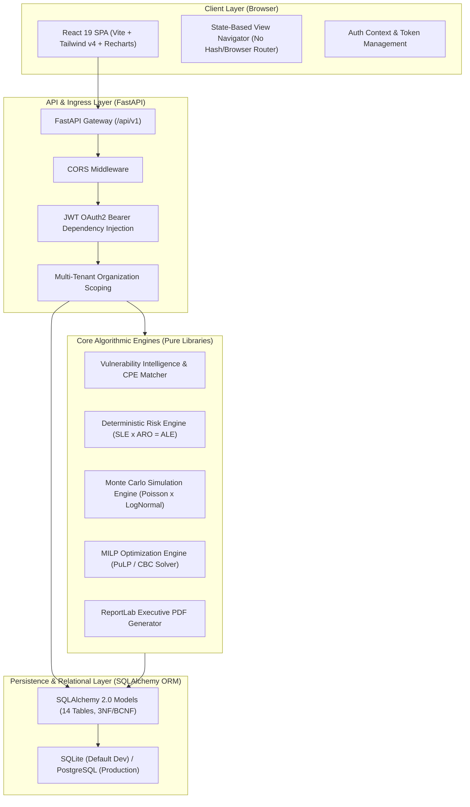
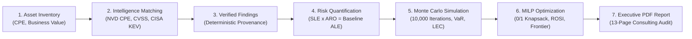

# Architecture & System Design Specification

This document provides a comprehensive technical overview of the architecture, modular separation, data pipelines, and design decisions behind the **PS105 Cyber Risk Quantification & Security Investment Optimization Platform**.

---

## 1. Architectural Style: Modular Monolith

PS105 is engineered as a **modular monolith**. Rather than fragmenting into distributed microservices that introduce distributed transaction overhead, network latency, and deployment complexity, PS105 consolidates domain models, analytical calculation engines, and client presentation within an enterprise-grade unified codebase.



### Key Architectural Boundaries

1. **Frontend Presentation (`frontend/`):** A client-side Single Page Application (SPA) built with React 19, TypeScript, and Vite. Utilizes Tailwind CSS v4 and an editorial warm design system (Newsreader serif, IBM Plex Sans, IBM Plex Mono). Implements state-based navigation across 11 modules with direct deep-linking support for the Platform Blueprint.
2. **API & Orchestration Layer (`backend/app/api/`):** FastAPI endpoints organized under `/api/v1/`. Responsible for request schema validation (Pydantic v2), JWT token verification, and enforcing multi-tenant organization boundaries.
3. **Pure Algorithmic Engines (`backend/app/engines/`):** Completely decoupled from web frameworks and relational databases. Receive dataclasses or plain dictionaries, execute mathematical calculations, and return strongly-typed output models.
4. **Relational Data Layer (`backend/app/models/` & `backend/app/database/`):** 14 third-normal-form (3NF/BCNF) entities mapped via SQLAlchemy 2.0. Database-level `CHECK` constraints enforce integrity guarantees (such as the XOR constraint on Risk provenance).

---

## 2. Quantitative Data Flow Pipeline

The PS105 analytical pipeline transforms raw infrastructure inventory and vulnerability intelligence into defensible capital allocation recommendations in six sequential phases:



### Detailed Pipeline Stages

1. **Asset Declaration:** Enterprise assets are declared with hardware/software specifications, Common Platform Enumeration (CPE) strings, installed versions, operational criticality, exposure factors ($EF$), and monetary business valuations.
2. **Vulnerability Correlation & Finding Generation:** The `FindingService` and `CPEMatcher` correlate asset software attributes against cached NIST NVD and CISA KEV records. Findings are flagged with confidence classifications (`VERIFIED`, `POTENTIAL`, `INSUFFICIENT_DATA`), eliminating false positives when installed versions fall outside vulnerable ranges.
3. **Deterministic Financial Risk Modeling:** The `RiskQuantificationEngine` converts each threat-asset pair into single loss expectancies ($SLE = \text{Asset Value} \times EF$) and annualized rates of occurrence ($ARO = \text{Threat Frequency} \times (1 + \text{Exploitability}/10)$), yielding the baseline Annualized Loss Expectancy ($ALE = SLE \times ARO$).
4. **Stochastic Uncertainty Simulation:** The `MonteCarloEngine` executes 10,000 iterations modeling threat frequency as a Poisson process ($\lambda = ARO$) and severity as a LogNormal distribution ($\mu = \ln(SLE) - \sigma^2/2, \sigma = 0.5$). Computes tail risk metrics ($P10, P50, P90, P95$) and generates the empirical Loss Exceedance Curve (LEC).
5. **Security Investment Capital Optimization:** The `OptimizationEngine` formulates a 0/1 Mixed-Integer Linear Program (MILP) solved via the COIN-OR CBC branch-and-cut solver. Evaluates additive mitigation under budget constraints, computes exact non-linear multiplicative portfolio residual loss ($ALE \times \prod (1 - E_{ij} x_i)$), and cross-validates against exhaustive $2^8 = 256$ state space enumeration.
6. **Executive Reporting:** The `ReportService` dynamically compiles the complete assessment, risk register, simulation percentiles, optimization tables, and vector charts into a 13-page boardroom-ready PDF.

---

## 3. Multi-Tenant Organization Isolation

PS105 is built for strict multi-tenancy:
* Every core entity (`User`, `Asset`, `Risk`, `Scenario`, `RiskAssessmentSnapshot`) belongs to an `Organization`.
* FastAPI dependencies (`get_current_user`) validate the JWT Bearer token, extract the caller's `organization_id`, and scope all database queries automatically:
  ```python
  # Example from backend/app/api/routes/assets.py
  assets = db.query(Asset).filter(
      Asset.organization_id == current_user.organization_id
  ).all()
  ```
* Cross-tenant access attempts return HTTP 404/403 errors, as verified by unit tests in `test_api.py::test_asset_organization_isolation`.

---

## 4. Technology Selection Rationale

| Layer | Technology | Engineering Rationale |
| :--- | :--- | :--- |
| **Frontend Framework** | React 19 + TypeScript | Concurrent rendering, strict compile-time type safety for complex financial payloads. |
| **Styling & Design** | Tailwind CSS v4 | High-performance CSS variable engine with zero-runtime stylesheet generation; seamless dark/light theme switching. |
| **Visualization** | Recharts (SVG) | Declarative React SVG charts for responsive, accessible dashboards (loss distributions, frontiers, exceedance curves). |
| **Typography** | Newsreader + IBM Plex | Editorial consulting aesthetics matching McKinsey / Gartner executive presentations. |
| **Backend API** | FastAPI (Python 3.13) | Asynchronous ASGI request handling, automatic OpenAPI 3.1 documentation, native Pydantic v2 validation. |
| **Optimization Solver** | PuLP (CBC Solver) | Open-source Mixed-Integer Linear Programming solver without proprietary license restrictions (Gurobi/CPLEX). |
| **Statistical Engine** | NumPy | High-performance vectorized random variate generation for 10,000-trial Monte Carlo runs in < 50ms. |
| **Report Generation** | ReportLab Platypus | Exact pixel-level page budget control, dynamic table wrapping, vector canvas drawing, and PDF/A metadata. |
| **Persistence** | SQLAlchemy 2.0 | Full Python typing, DeclarativeBase ORM, database-agnostic portability between SQLite and PostgreSQL. |
