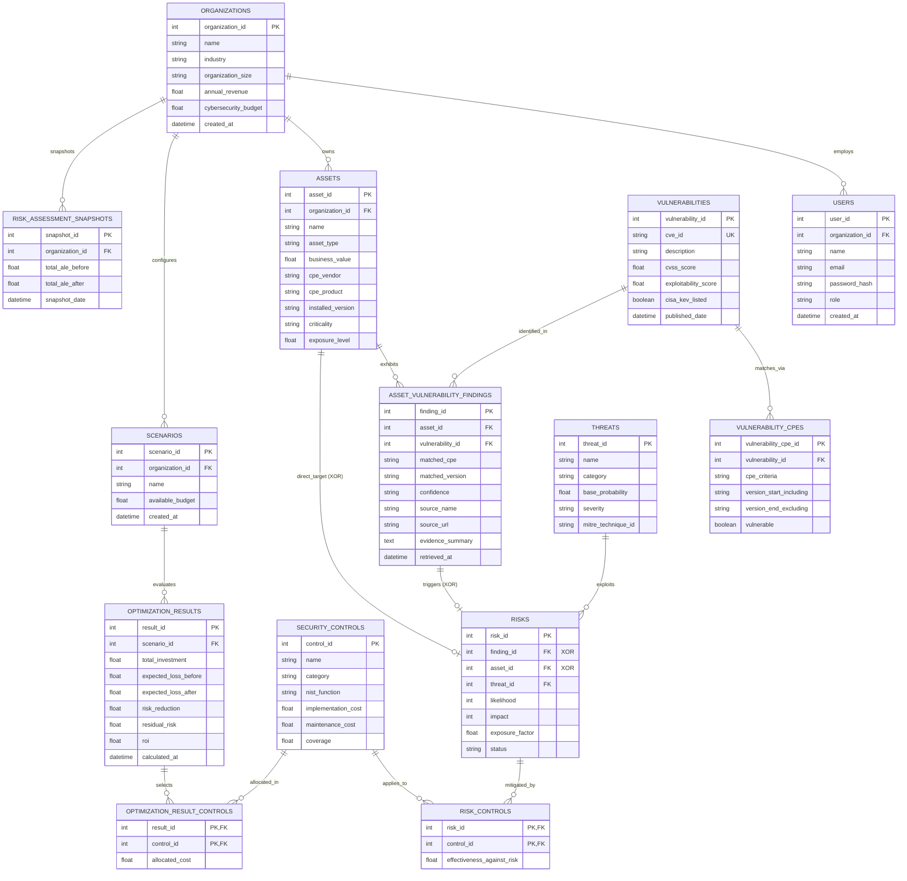

# Database Schema & Relational Data Model Specification

This document details the relational schema, entity relationships, normal forms, and integrity constraints of the **PS105 Cyber Risk Quantification & Security Investment Optimization Platform**.

---

## 1. Relational Entity-Relationship Diagram



---

## 2. Normalization Analysis (3NF & BCNF Compliance)

The PS105 database schema is normalized to **Third Normal Form (3NF)** and **Boyce-Codd Normal Form (BCNF)** to eliminate update anomalies, deletion anomalies, and data redundancy:

1. **First Normal Form (1NF):** Every attribute contains only atomic values; there are no repeating groups or comma-separated lists. Many-to-many relationships (e.g., Risks to Controls, Optimization Results to Controls) are resolved into associative junction tables (`risk_controls`, `optimization_result_controls`).
2. **Second Normal Form (2NF):** Every non-key attribute is fully functionally dependent on the entire primary key. In composite primary key tables (`risk_controls` on `(risk_id, control_id)`), the only non-key attribute `effectiveness_against_risk` depends strictly on the specific pairing of risk and control.
3. **Third Normal Form (3NF):** No transitive dependencies exist. For example, `asset_vulnerability_findings` stores `asset_id` and `vulnerability_id`; vulnerability details (`cvss_score`, `exploitability_score`, `cisa_kev_listed`) reside solely in `vulnerabilities` and are never duplicated in findings.
4. **Boyce-Codd Normal Form (BCNF):** For every non-trivial functional dependency $X \rightarrow Y$, $X$ is a superkey.

---

## 3. Database-Level CHECK Constraints & Integrity Invariants

The data model enforces mathematical and physical domain invariants directly at the database engine level:

### 1. Risk Provenance Exclusive OR (XOR) Constraint
A `Risk` record represents either a vulnerability-specific exploit scenario or an inherent direct threat to an asset. It must link to **either** a `finding_id` or an `asset_id`, but never both and never neither:
```sql
CHECK (
    (finding_id IS NOT NULL AND asset_id IS NULL) OR
    (finding_id IS NULL AND asset_id IS NOT NULL)
)
```

### 2. Probability & Rating Boundaries
* **Threat Probability:** `base_probability >= 0.0 AND base_probability <= 1.0`
* **Vulnerability CVSS & Exploitability:** `cvss_score BETWEEN 0.0 AND 10.0`, `exploitability_score BETWEEN 0.0 AND 10.0`
* **Risk Likelihood & Impact:** `likelihood BETWEEN 1 AND 5`, `impact BETWEEN 1 AND 5`
* **Exposure Factor & Control Coverage:** `exposure_factor BETWEEN 0.0 AND 1.0`, `coverage BETWEEN 0.0 AND 1.0`
* **Control Effectiveness:** `effectiveness_against_risk BETWEEN 0.0 AND 1.0`
* **Fiscal Costs:** `implementation_cost >= 0.0`, `maintenance_cost >= 0.0`

---

## 4. Entity Catalog (14 Tables)

| Table Name | Purpose | Primary Key | Foreign Keys | Key Constraints |
| :--- | :--- | :--- | :--- | :--- |
| `organizations` | Multi-tenant tenant boundaries & fiscal profiles | `organization_id` | - | Unique `name` |
| `users` | Authenticated analysts & CISO administrators | `user_id` | `organization_id` | Unique `email` |
| `assets` | Monitored hardware, software, and cloud assets | `asset_id` | `organization_id` | - |
| `vulnerabilities` | Curated CVE intelligence records | `vulnerability_id` | - | Unique `cve_id` |
| `vulnerability_cpes` | NIST CPE version ranges and matching criteria | `vulnerability_cpe_id` | `vulnerability_id` | - |
| `asset_vulnerability_findings` | Deterministic matches between assets and CVEs | `finding_id` | `asset_id`, `vulnerability_id` | - |
| `threats` | Threat scenario catalog (MITRE ATT&CK aligned) | `threat_id` | - | Unique `name` |
| `risks` | Financial risk scenarios (SLE x ARO = ALE) | `risk_id` | `finding_id`, `asset_id`, `threat_id` | XOR check constraint |
| `security_controls` | Defensible candidate controls & costs | `control_id` | - | Unique `name` |
| `risk_controls` | Mitigation effectiveness of control on risk | `(risk_id, control_id)` | `risk_id`, `control_id` | Composite PK |
| `scenarios` | Budget allocation planning scenarios | `scenario_id` | `organization_id` | - |
| `optimization_results` | Optimal portfolio solutions from MILP solver | `result_id` | `scenario_id` | - |
| `optimization_result_controls` | Junction table of controls selected in scenario | `(result_id, control_id)` | `result_id`, `control_id` | Composite PK |
| `risk_assessment_snapshots` | Historical ALE baseline vs residual trends | `snapshot_id` | `organization_id` | - |
