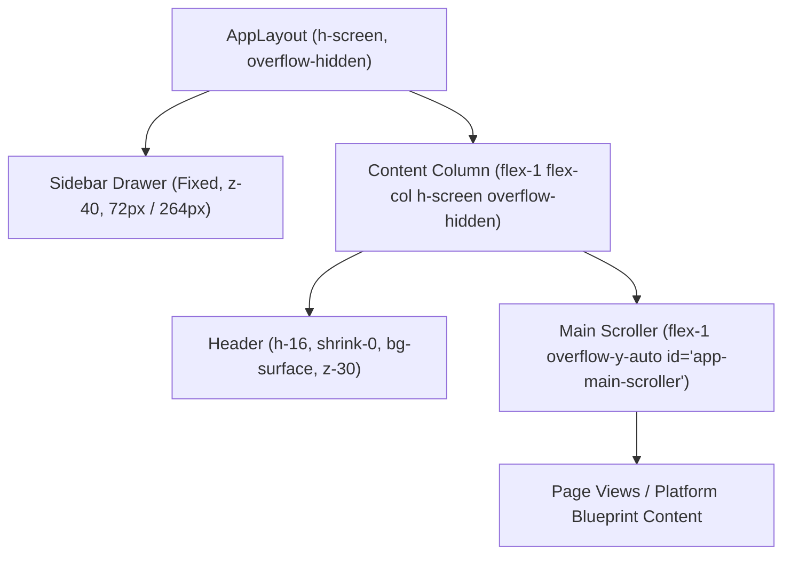

# Design System & UI Architecture Specification

This document details the editorial aesthetic, semantic design tokens, typographical hierarchy, and layout contract governing the **PS105 Web Application**.

---

## 1. Editorial Aesthetic & Design Philosophy

The PS105 frontend diverges from generic dark-mode developer dashboards. It adopts a **consulting-grade editorial design language** modeled on elite financial journals and executive advisory reports (The Economist, Financial Times, McKinsey quarterly reports).

### Core Design Principles
* **Warm "Paper" Palette:** Calibrated off-white warm parchment backgrounds (`#F5F2EA`) that reduce ocular fatigue and enhance legibility during deep quantitative audits.
* **Editorial Typography:** High-contrast serif headlines for authority, paired with clean neo-grotesque sans-serif for structured tables and monospaced glyphs for cryptographic tokens and CVE identifiers.
* **Restrained Semantic Accents:** Color is used strictly to convey risk and financial status:
  * Brand Green: Strategic stability and enterprise security posture.
  * Amber / Warn: Elevated threat arrival or moderate risk exposure.
  * Carmine / Danger: Critical CVE exposure or unacceptable tail loss.
  * Tabular Numerals: Tabular figures (`tabular-nums`) enforce rigid decimal alignment across financial ledger columns.

---

## 2. Design Tokens & Theme Variables

All design tokens are defined as CSS variables in `frontend/src/index.css` and mapped to Tailwind CSS v4 `@theme inline`:

| Token Name | Light Theme ("Paper") | Dark Theme ("Obsidian") | Semantic Usage |
| :--- | :--- | :--- | :--- |
| `--bg` | `#F5F2EA` | `#111613` | Main canvas background |
| `--surface` | `#FFFFFF` | `#181F1B` | Primary card & panel container |
| `--surface-2` | `#FAF8F3` | `#1D2621` | Secondary nested container / table header |
| `--ink` | `#17211C` | `#EDE9DD` | Primary high-contrast text |
| `--ink-muted` | `#5C6760` | `#9AA59E` | Secondary explanatory prose & captions |
| `--line` | `#E4DFD2` | `#2A332E` | Structural borders & card dividers |
| `--brand` | `#1E4D3F` | `#7FC4A6` | Brand identity & primary interactive CTA |
| `--brand-soft` | `#E3EDE8` | `#1F3329` | Subtle brand highlighting |
| `--warn` | `#B7791F` | `#E0B05A` | Medium severity & threshold alerts |
| `--danger` | `#A8352A` | `#E0786C` | High/Critical severity & vulnerability tags |
| `--ok` | `#2F7D4F` | `#6CC28F` | Optimal investments & verified protections |

---

## 3. Typographical Hierarchy

```css
@theme inline {
  --font-serif: "Newsreader", Georgia, serif;
  --font-sans: "IBM Plex Sans", system-ui, sans-serif;
  --font-mono: "IBM Plex Mono", ui-monospace, monospace;
}
```

* **Display Headings (`h1`, `h2`, `h3`):** Newsreader serif with optical sizing and tight tracking (`letter-spacing: -0.01em`).
* **Interface Body & Tables:** IBM Plex Sans at 13px–14px (`text-xs` / `text-sm`) with 1.5 line height.
* **Financial Metric Values (`.num`):** Newsreader with `font-variant-numeric: tabular-nums` to guarantee aligned decimals across currency columns.
* **Telemetry & Codes (`.bp-mono`):** IBM Plex Mono for CVE tags, CPE criteria, and mathematical symbols.

---

## 4. App Shell Layout Contract & Z-Index Scale

To eliminate layout jank, sticky header collisions, and scrollbar clipping, PS105 establishes a single layout contract:



### Stacking Z-Index Scale (Documented in `index.css`)
```
- Content Layer: 0
- Page Sticky Headers & Navigation Chips: 10
- Right-Rail Table of Contents: 10
- Floating Back-to-Top Button: 20
- App Header (Workspace, Theme, Logout): 30
- Sidebar & Mobile Drawer: 40
- Tooltips, Dropdowns & InfoTip Portals: 50
- Modals, Dialogs & Global Alerts: 60
```

### Invariant Rules
1. **Header Outside Scroller:** The application header is a stationary sibling to `<main id="app-main-scroller">`. Page content can never scroll over or under the header.
2. **Sidebar Collapse Toggle:** Positioned on the sidebar's right edge at `top: calc(var(--app-header-h) / 2 - 12px)` and `z-40`, vertically centered with the brand header row.
3. **Portalized InfoTip Tooltips:** All interactive guidance popups (`InfoTip.tsx`) render via `ReactDOM.createPortal` attached to `document.body` at `z-50`, preventing clipping by parent card `overflow: hidden`.
