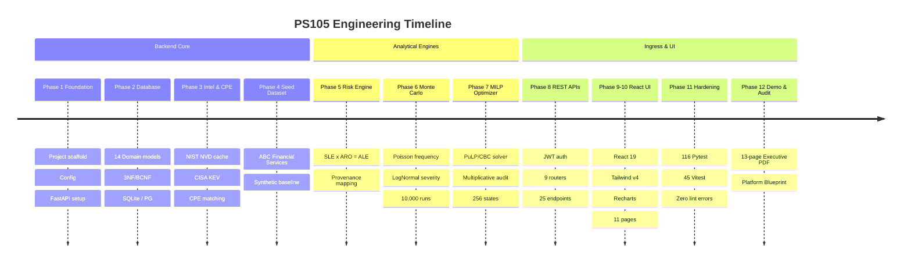

# Development Phases & Implementation History

This document outlines the phased engineering roadmap and milestone history of the **PS105 Cyber Risk Quantification & Security Investment Optimization Platform**.

---

## 1. Phase-by-Phase Milestone Summary

---

## 2. Detailed Phase Log

### Phase 1: Foundation & Backend Scaffold
* Established Python 3.13 project structure, Pydantic v2 `BaseSettings`, logging, and CORS middleware.
* Configured SQLite local default (`DATABASE_URL=sqlite:///./ps105.db`) with PostgreSQL connection string compatibility.

### Phase 2: Relational Database & Domain Models (17 Tests)
* Implemented 14 SQLAlchemy 2.0 DeclarativeBase models in 3NF/BCNF.
* Encoded database-level `CHECK` constraints including the Risk provenance Exclusive OR (`ck_risks_xor_finding_asset`).
* Added cascade delete rules and composite keys (`risk_controls`, `optimization_result_controls`).

### Phase 3: Vulnerability Intelligence, CPE Matcher & Provenance Engine (34 Tests Cumulative)
* Ingested real-world public CVE facts (CVE-2021-41773, CVE-2022-1552, CVE-2023-23397).
* Built semantic version comparison engine (`VersionCompare`) handling open/closed interval bounds (`version_start_including`, `version_end_excluding`).
* Engineered false-positive elimination: assets without installed version strings return `INSUFFICIENT_DATA` rather than spurious vulnerability alerts.

### Phase 4: Synthetic ABC Financial Services Demonstration Dataset (39 Tests Cumulative)
* Populated reproducible synthetic demonstration profile:
  * Annual Revenue: ₹50.0 Cr
  * Annual Cybersecurity Budget: ₹25.0 Lakh
  * 4 Assets: Core Banking DB (₹2 Cr), Payment Gateway API (₹1.5 Cr), Employee Workstations (₹0.5 Cr), Cloud Infrastructure (₹1.0 Cr).
  * 5 Threats: Web exploitation, database exfiltration, phishing, ransomware, cloud misconfiguration.
  * 8 Candidate Controls: MFA, EDR, Immutable Backup, Security Training, SIEM, Firewall Upgrade, Pen Testing, Network Segmentation.
  * 15 Defensible Risk-Control effectiveness mappings.

### Phase 5: Deterministic Financial Risk Engine
* Derived Single Loss Expectancy ($SLE = \text{Asset Value} \times EF$) and Annualized Rate of Occurrence ($ARO = \text{Threat Frequency} \times M_{\text{exploit}}$).
* Implemented deterministic baseline loss calculation ($ALE = SLE \times ARO$).

### Phase 6: Monte Carlo Stochastic Simulation Engine
* Implemented vectorized Poisson arrival and LogNormal severity generation in NumPy across 10,000 trials.
* Parameterized log-severity with median $\mathbb{E}[X] = SLE$ and dispersion $\sigma = 0.5$.
* Extracted empirical loss percentiles ($P10, P50, P90, P95$) and dynamic Loss Exceedance Curve (LEC).

### Phase 7: MILP Optimization & Exact Multiplicative Evaluation
* Formulated 0/1 Knapsack optimization problem using PuLP and the COIN-OR CBC branch-and-cut solver.
* Built exact multiplicative residual risk post-evaluator ($\prod (1 - E_{ij} x_i)$) to correct for additive linear solver approximations.
* Engineered brute-force $2^8 = 256$ state space enumeration engine to mathematically verify global solver optimality.

### Phase 8: Service Layer & REST APIs (9 Routers, 25 Endpoints)
* Implemented REST endpoints across Authentication, Organizations, Assets, Vulnerabilities, Risks, Controls, Simulations, Optimization, and Reports.
* Added JWT OAuth2 Bearer token generation, password hashing via Bcrypt, and multi-tenant scoping.

### Phases 9–10: React 19 Frontend Application Shell
* Built Single Page Application with React 19, TypeScript, Vite, and Tailwind CSS v4.
* Constructed 11 cohesive business views (Overview, Assets, Vulnerabilities, Risks, Simulations, Optimization, Scenarios, Reports, Settings, Blueprint, Auth).
* Rendered financial charts with Recharts (loss distributions, budget utilization, efficient frontiers).

### Phase 11: System Hardening & Verification
* Hardened multi-tenant isolation boundaries with explicit unit and integration tests.
* Validated complete suite: 116 backend pytest tests, 45 frontend vitest tests, 0 oxlint errors.

### Phase 12: End-to-End Demonstration & Executive Reporting
* Built 13-page consulting-grade ReportLab PDF generator with custom vector canvas drawings, dynamic TOC, and selectable sections.
* Conducted full board-level demonstration walk-through for ABC Financial Services.

---

## 3. Post-Phase Enhancements & Refinements

1. **Design System Refresh:**
   * Introduced warm editorial paper light theme (`#F5F2EA` background, `#17211C` ink) and obsidian dark theme (`#111613` background, `#EDE9DD` ink).
   * Elevated typography with Newsreader (serif), IBM Plex Sans, and IBM Plex Mono.
   * Redesigned app shell with header outside the scroller container, collapsible sidebar, and portalized `InfoTip` tooltips.
2. **Platform Blueprint Page:**
   * Engineered comprehensive 12-section technical documentation page directly within the web application.
   * Features interactive scrollspy, KaTeX mathematical formulas, architecture diagrams, and indexed glossary.
3. **Executive PDF Consulting Polish:**
   * Added dynamic section numbering (`_snum()`) supporting arbitrary `?sections=` query parameters without gaps in numbering or Table of Contents.
   * Fixed loss exceedance curve data bindings and added scenario code labels ($S1, S2, S3$) with dynamic legends to the Efficient Frontier chart.
   * Integrated triple revenue sanity callouts to verify realistic financial scaling.
4. **Methodological Transparency:**
   * Removed all unverified claims of "ISO 27005 compliance" and "FAIR certification".
   * Explicitly documented FAIR-inspired methodology, synthetic assumptions, and local vulnerability data caching.
   * Scaled demo asset valuations by $0.1\times$ to establish an industry-realistic baseline ALE-to-revenue ratio of 4.06%.
