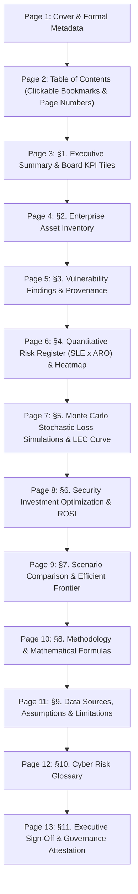

# Executive PDF Report Structure & Generation Specification

This document details the architectural layout, page budget, flowables, vector charts, and dynamic section rendering of the **13-page Executive Cyber Risk Report** generated by `backend/app/services/report_service.py`.

---

## 1. Boardroom Consulting-Grade 13-Page Map



---

## 2. Page-by-Page Specifications

### Page 1: Cover Page
* **Visual Anchor:** Full-width deep emerald cover banner (`#1E4D3F`) with gold accent rule (`#B7791F`).
* **Metadata Table:** Target Organization name, industry classification, enterprise revenue, cybersecurity budget, author/analyst, report generation timestamp, and confidentiality classification.
* **Typographical Safeguard:** Title formatted with `KeepTogether` and balanced font sizes to prevent orphan words on trailing lines.

### Page 2: Table of Contents
* **Two-Pass Generation:** Utilizes a custom `multiBuild` with an `afterFlowable` callback collecting target section page numbers.
* **Layout:** Numbered section titles paired with dotted leader lines (`. . . . .`) and right-aligned target page numbers.
* **Internal Bookmarks:** Clicking any section title in a compliant PDF viewer jumps directly to the section anchor.

### Page 3: 1. Executive Summary & Board KPI Tiles
* **Boardroom Synthesis:** High-level narrative summarizing annual risk exposure and optimal portfolio mitigation.
* **Four KPI Tiles:**
  1. *Baseline ALE:* e.g. `₹2.03 Cr` (Total unmitigated expected annual loss).
  2. *Residual Loss:* e.g. `₹36.92 L` (Post-mitigation annual loss).
  3. *Risk Reduction:* e.g. `81.8%` (Net loss reduction percentage).
  4. *Optimal Spend:* e.g. `₹22.75 L` with subline `of ₹25.00 L budget`.
* **ROSI Callout:** Net return formatted uniformly as `{n}×` when exceeding 10× (e.g. `6.30×` net return on first-year cost).
* **Revenue Sanity Alerts:** Automatically renders alert boxes if baseline ALE or total asset values exceed annual turnover.

### Page 4: 2. Enterprise Asset Inventory
* Tabular ledger of all declared organizational assets: Asset Name, Type/Category, Business Valuation (₹), Criticality rating, and correlated software stack (CPE Vendor, Product, Installed Version).

### Page 5: 3. Vulnerability Findings & Provenance
* Deterministic findings ledger: CVE ID, CVSS v3.1 Base Score, CISA KEV exploitation status (`YES` / `NO`), Matched CPE criteria, Target Asset, and confidence classification (`VERIFIED`).
* Explanatory caption clarifying that CPE indicates vulnerable criteria while version denotes installed asset state.

### Page 6: 4. Quantitative Risk Register & 5×5 Heatmap
* **Quantitative Register:** Sorted strictly by Baseline ALE descending: Threat scenario, target asset, Likelihood ($L$), Impact ($I$), Single Loss Expectancy ($SLE$), Annualized Rate of Occurrence ($ARO$), Baseline Annualized Loss Expectancy ($ALE$), and severity rating.
* **5×5 Likelihood × Impact Heatmap:** Vector-drawn matrix placing Likelihood on the vertical axis (L1–L5) and Impact on the horizontal axis (I1–I5). Uses unified risk band tints (`#FCE7E4`, `#F7E4E1`, `#F6ECD6`, `#E2F1E8`) matching the register ratings, complete with a color legend row.

### Page 7: 5. Monte Carlo Stochastic Loss Simulations
* Parameter summary table documenting 10,000 iterations, Poisson arrival parameters, LogNormal dispersion assumption ($\sigma = 0.5$), and extracted percentiles ($P10, P50, P90, P95$).
* **Loss Exceedance Curve (LEC):** Vector-rendered curve plotting $P(\text{Annual Loss} > x)$ with numeric tick labels on both axes and a callout highlighting the 95th percentile Value-at-Risk ($VaR_{95}$).

### Page 8: 6. Security Investment Optimization & ROSI
* Table of solver-selected controls displaying Unit Cost (₹), Individual Risk Reduction (₹), and Share of Total Portfolio Reduction.
* Summary total row: `"Total: ₹22.75 L · 81.8% risk reduction"`.
* Explanatory paragraph listing candidate security controls not selected due to fiscal budget limits.

### Page 9: 7. Scenario Comparison & Efficient Frontier
* Comparative ledger of alternative fiscal allocations (Conservative, Executive, Maximum Hardening).
* **Efficient Frontier Chart:** Vector plot mapping Spend (x-axis) vs Residual Loss (y-axis), labeled with scenario codes ($S1, S2, S3$) and an accompanying legend.
* **Frontier Takeaway:** Dynamically computed marginal risk-reduction points per ₹1.0 Lakh spend between consecutive budget scenarios.

### Page 10: 8. Methodology & Mathematical Formulas
* Rigorous reference table documenting full names, definitive formulas, and operational meanings for $SLE, ARO, ALE, EF, ROSI$, Poisson frequency, LogNormal dispersion, Knapsack MILP, and exhaustive $2^N$ validation.
* Replaces mathematical non-ASCII glyphs with standard text (`in`, `x`, `<=`, `>=`) for font rendering reliability.

### Page 11: 9. Data Sources, Assumptions & Limitations
* Dedicated governance disclosure explaining synthetic demonstration parameters, manual asset inventory entry, cached NVD and CISA KEV feeds, and absence of active network scanning.

### Page 12: 10. Cyber Risk Glossary
* Formal searchable lexicon defining core technical and economic acronyms: ALE, ARO, CISA, CPE, CVE, CVSS, CWE, EF, KEV, LEC, MILP, MITRE ATT&CK, NVD, ROSI, SLE, VaR.

### Page 13: 11. Executive Sign-Off & Governance Attestation
* Formal approval register featuring signature and date blocks for Chief Information Security Officer (CISO) and Chief Financial Officer (CFO).

---

## 3. Dynamic Section Selection via REST API

The executive report generator supports modular page composition. Clients can request any arbitrary subset of sections via the `?sections=` query parameter:

```http
GET /api/v1/reports/executive-pdf?sections=summary,risks,optimization,limitations
```

### Dynamic Numbering Engine (`_snum()`)
The service dynamically re-sequences section numbers in both headings and Table of Contents entries:
1. Cover and TOC are always rendered.
2. Selected sections are numbered sequentially ($1., 2., 3., \dots$) with zero numbering gaps.
3. The Sign-Off page automatically takes the final sequential number ($N+1$).
